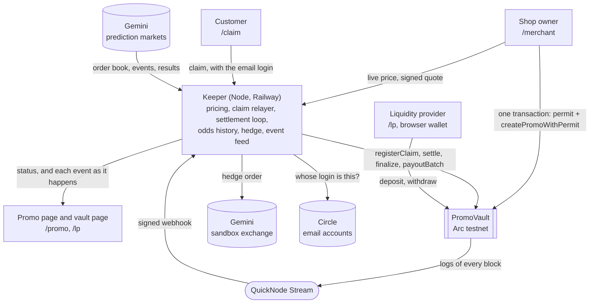

# FreeIf

Merchants run "your purchase is free if X happens" promotions. A USDC vault on Arc underwrites each promo at live Gemini prediction-market odds plus a spread. When Gemini settles the market, every registered customer is paid automatically.

Built for the UBC Hackathon 2026 (DeFi track), by one person, starting Nov 12. It runs on Arc testnet with test dollars.

| | |
|---|---|
| Try it | [`https://freeif.app/merchant`](https://freeif.app/merchant) (add `?mechanics=1` to see where each number comes from). Paying for a promo needs test USDC in the account your email login makes: the Pay sheet shows the account's address, and [Circle's faucet](https://faucet.circle.com) sends test USDC on Arc Testnet |
| The contract | [`0x68a00243927f250dBcD9160b5d06623b62B2e06d`](https://explorer.testnet.arc.io/address/0x68a00243927f250dBcD9160b5d06623b62B2e06d) on Arc testnet, verified |
| Sponsor sections | [How Arc is used](#how-arc-is-used) · [How Gemini is used](#how-gemini-is-used) · [The QuickNode Stream](#the-quicknode-stream) |
| For the track | [Economic design](#economic-design) · [Risks and assumptions](#risks-and-assumptions) |

## The problem

"Buy it today, and it is free if our team wins" is an old promotion, and it works. In 2007 Jordan's Furniture promised about 30,000 customers a refund if the Red Sox won the World Series, and bought an insurance policy to pay for it ([NPR](https://www.npr.org/transcripts/15636597), during the Series). The Red Sox won. That policy is prize-indemnity insurance: written by negotiation, for promotions large enough to be worth an underwriter's time.

A merchant without such a policy is on their own. In 2019 the Houston furniture retailer Jim "Mattress Mack" McIngvale covered his World Series refund promotion himself, with about $13 million of bets at casinos that he told CNN were "more of an insurance policy" ([KTVZ](https://ktvz.com/news/2019/10/31/houstons-mattress-mack-lost-13-million-in-bets-on-the-astros-world-series-loss-but-says-hed-do-it-again/)). In June 2026 a bar in Washington DC tied its tabs to a World Cup game and covered it by buying prediction-market contracts by hand ([Axios](https://www.axios.com/local/washington-dc/2026/06/17/dc-bar-free-tabs-world-cup-kalsh-team-usa)).

A pizza shop has no underwriter to call and should not need a trading account. Run without cover, the promotion is a bet the shop loses on its busiest night.

## What FreeIf does

It sells that cover as one fixed price, paid once, and pays the customers itself.

1. **The shop sets it up** ([`/merchant`](https://freeif.app/merchant), under a minute). Pick a game and a team from a list, say what is free and what it costs, and how many customers. The form shows the chance, the most the shop could owe, and one cost: for wings at $8 for two customers if the Patriots win, $7.06 when the chance was 42%. Pay with an email login. The shop gets a code for its counter.
2. **A customer gets covered** (`/claim/[id]`, about ten seconds). Scan the code, type an email and the 6-digit code it is sent. The card reads "Wings", "$8.00", "Free if the Patriots win", and is stamped COVERED. No app, no fee, nothing to install.
3. **The game is played.** Nobody does anything. The promo's page shows how the chance moves.
4. **The result comes in.** Gemini settles the market, the keeper posts the result to the vault, and after a dispute window the vault pays every covered customer. The card turns over: "$8.00", "✓ PAID". If the team loses, nobody is owed anything and the shop has paid what it agreed to pay.

Behind it is a vault of USDC on Arc. Liquidity providers fund it ([`/lp`](https://freeif.app/lp)); every promo's whole payout is locked in it until the result; the price of a promo is what its hedge would cost on Gemini's prediction market, plus 5%.

The same contract also pays the shop itself. "My business gets paid" on the form sells a cover: a fixed amount to the business if a day's high temperature in its city lands in a range it picks, priced from Gemini's daily temperature markets. [Promo 21](https://freeif.app/promo/21) is the first: $2.00 to a test shop if the high in Austin on November 14 is 66°F or below, for $0.80.

Merchant and customer screens never say prediction market, USDC, wallet or gas. One switch (`?mechanics=1`, or the link in the footer) shows what is under each number: the Gemini contract and its order book, the signed quote, the transactions on Arc, how each event reached the page.

## How it fits together



- **`PromoVault`** holds all the money and enforces every rule about it: who may create a promo and at what price (a quote signed by the pricer), what is locked, who is covered, when a result is final, who is paid.
- **The keeper** is one Node process. It reads Gemini, prices promos and signs quotes, registers customers, posts results and pays, places each promo's hedge order on Gemini's sandbox where the sandbox lists the contract (and records the order as simulated where it does not), and passes the vault's events to the pages. It holds three keys (pricer, oracle, relayer) and no customer money.
- **The web app** is what people see. Accounts are Circle user-controlled wallets behind an email code; a merchant's payment is one transaction from that account.
- **The QuickNode Stream** carries the vault's events from the chain to the keeper, which pushes them to every open page.

## Layout

| Folder | What it holds |
|---|---|
| `contracts/` | `PromoVault.sol` and its tests (Foundry) |
| `keeper/` | Node service: game list, pricing, settlement keeper, claim relayer, and the event feed behind a QuickNode Stream webhook |
| `web/` | Next.js app for merchants and customers, and the vault's page for liquidity providers |

## What is live

| | |
|---|---|
| Vault | [`0x68a00243927f250dBcD9160b5d06623b62B2e06d`](https://explorer.testnet.arc.io/address/0x68a00243927f250dBcD9160b5d06623b62B2e06d) on Arc testnet (chain 5042002), verified |
| App | [`https://freeif.app`](https://freeif.app): [`/merchant`](https://freeif.app/merchant) sets up a promo, `/claim/[id]` covers a customer, `/promo/[id]` is its status page, [`/lp`](https://freeif.app/lp) is the vault for liquidity providers. Add `?mechanics=1` to see where each number comes from. Details in [`web/README.md`](web/README.md) |
| Keeper | `https://freeif-production.up.railway.app` ([`/health`](https://freeif-production.up.railway.app/health)), API in [`keeper/README.md`](keeper/README.md) |
| First payout | [`0xfa5224c6…3fd5235`](https://explorer.testnet.arc.io/tx/0xfa5224c67e6c4bddfed785966555073b0739771081b9067fa3b4c747a3fd5235): three customers paid after Gemini settled a 5-minute BTC market "yes" |
| So far (Nov 13) | 22 promos created. 19 have run to their end: 9 paid their customers, 10 ended "no". Three are open: two on Sunday's Patriots at Lions game and one on Saturday's high in Austin |
| Settings on the vault (Nov 13) | `maxExposureBps` 2000 (20%). `disputeWindow` 30 seconds and `voidGrace` 60 seconds, which are test values: the contract's defaults are one hour and 7 days. The owner is one account, the deployer |
| Demo video | Added with the submission |

## Economic design

**Who pays whom.** A merchant pays a premium once, when the promo is created. The vault locks the promo's whole payout (customers × amount each) from that moment, premium included, until there is a result. On a "yes" each covered customer is paid the amount, and the part nobody claimed goes back to the vault. On a "no" the lock is released and the premium stays in the vault: that is what liquidity providers earn.

**The price.** `premium = chance × payout × (1 + spread)`, rounded up to a cent.

- The chance is what a dollar of the promo's payout would cost as "yes" contracts on Gemini right now, bought from the order book's offers, cheapest first. For a promo that fits inside the best offer that is the ask. It is what the vault's hedge would cost at the moment of the quote, so a promo that Gemini's offers cover is not sold below the cost of laying it off.
- The spread is 5%. The part of a payout that Gemini's book does not offer cannot be hedged, and carries 15%. A book with a side missing carries 15% on all of it, and is refused when the result has never traded.
- Worked example: Lions to win at an ask of 0.39, $20 back for each of 200 customers. The most the vault can owe is $4,000. The expected loss is $1,560, the premium is $1,638, and the vault's own money at risk is $2,362. The merchant pays 41% of the face value for a 39% event.
- A quote is signed by the pricer key (EIP-712), names the merchant, expires in 90 seconds and can be used once. `createPromo` accepts nothing else.

**Limits.** Three, and a promo must pass all of them.

| Limit | Where | What it stops |
|---|---|---|
| One promo may put at most 20% of the vault's free balance at risk (`maxPayout - premium`) | The contract (`maxExposureBps`); the pricing service uses 90% of it | One promo taking the vault down |
| No more than 60% of the vault may be locked, counting quotes that are signed and still usable | The pricing service | Many promos doing it together. The contract has no cap across promos |
| The premium may not exceed the payout | Both | Selling a result that is nearly certain |

**Collateral.** `lockedCollateral` is the sum of every promo's lock plus payouts that failed and wait. Every function that moves USDC keeps `balance >= lockedCollateral`, and a withdrawal is priced on `balance - lockedCollateral`, so a liquidity provider leaving can never reach a promo's payout. This is the property the tests lean on hardest: 238 unit and fuzz tests, and two stateful invariant runs, each with its own handler (the second written in a review before the contract freeze), that make random calls and check it after every one.

**Shares.** Liquidity providers hold proportional shares, and there are two prices.

- A withdrawal is priced on the free balance: the least the shares can be worth.
- A deposit is priced on the free balance plus the locks of promos with no final result: the most they can be worth. Priced any lower, a deposit made just before a lock is released would take the lock from the providers who carried the risk. A review before the first deploy found exactly that. It was fixed, with tests that fail on the old code, before anything was deployed.
- The first deposit leaves 1,000 base units of shares (a tenth of a cent) at a dead address for good, so the first depositor cannot push the share price up with a donation and round the next deposit down to nothing.
- The cost of the two prices: a provider who leaves while promos are open gives up their part of the locks to those who stay. [`/lp`](https://freeif.app/lp) shows "withdrawable now" next to "your part of locks" and says what a withdrawal leaves behind before it is made.

**The hedge.** A "yes" contract pays $1, so one contract per dollar of payout is the other side of the vault's position. In the worked example the full hedge costs $1,560 of the $1,638 premium and leaves the $78 spread, with basis risk in place of the promo's risk. For every open promo the keeper works out that order. Where Gemini's sandbox exchange lists the contract (crypto and commodity markets) it places the order and keeps its id with the promo; for a game or a temperature market, which the sandbox does not list, it records the order it would place, marked simulated. The three promos open on Nov 13 are simulated; four test promos on BTC markets had real sandbox orders. Either way no money moves, and the vault as built carries each promo's risk itself. Moving USDC to Gemini and back is not built.

**What the vault has done.** On Nov 13 it held $65.58 with $26.00 locked for three open promos, and was up $3.74 on the 19 promos that had finished (premiums kept, less payouts). The page has the numbers as they are now.

## Risks and assumptions

This is a testnet demo, unaudited. What it trusts, and what can go wrong:

- **The result is posted by one key.** The oracle key posts Gemini's result. The contract checks that the event id it is given hashes to the one stored when the promo was sold, and emits the id and Gemini's `resolutionSide` as plain text, so anyone can compare a settlement with Gemini's own answer. A result is not final until a dispute window has passed (an hour by default; the deployed vault runs test promos with 30 seconds), and the owner can veto it within that window. Nobody else can. A wrong result that is posted and not vetoed is paid.
- **The price is signed by one key.** A pricer that signs a price too low gives the vault's money away, inside the limits above. The limits are the contract's 20% per promo and the pricing service's 60% in all.
- **The owner is trusted.** The owner can pause new deposits, new promos and new claims, change the limits and windows, veto a result, void a promo that has no standing result once a grace period after its market's close has passed (meant for a market Gemini voids or never settles; the contract does not check why; the merchant is refunded), and replace the pricer and the oracle. An owner who replaces them controls prices and results. A pause cannot trap money: withdrawals, settlement, payouts and refunds work while paused. A multisig and a timelock are roadmap.
- **The vault is not hedged.** The hedge is a sandbox order. Promos on the same game win or lose together, and the only limit across promos is the pricing service's.
- **Gemini's price can be thin or wrong.** The chance comes from one order book. A book with one side, or with its sides more than half a dollar apart, is priced with a wider spread or refused, and a promo bigger than the offers pays more for the part past them. A real hedge would also carry basis risk: Gemini's sandbox is not its live exchange, and a quote is good for 90 seconds while the book moves. On a market that is already running (the test loop's 5 and 15-minute markets) those 90 seconds are time to watch the price and use the quote only if it moved the buyer's way, so the keeper signs a quote on one only for a request that carries its secret test key (`CLAIM_TEST_KEY`), and not at all with the key unset. An event with no start time that is not a day's temperature is not sold.
- **Liquidity providers.** Leaving while promos are open forfeits a part of their locks (above). A deposit made while promos are open takes their loss side and none of their premium.
- **Who is a customer.** Nothing on chain proves that a covered customer bought anything. The controls are the code at the counter, one cover per email login per promo (the keeper asks Circle whose login a claim carries), and the customer cap the merchant paid for. The fix is the till issuing the claim. While the test loop is in use the keeper also takes a claim with no login when the request carries a secret test key it holds (`CLAIM_TEST_KEY`), the same key a quote on a test market needs (above); with the key unset that way in does not exist.
- **Accounts.** Merchant and customer accounts are Circle user-controlled wallets behind an email code. Whoever controls the email controls the account.
- **A payout that fails.** A transfer that fails does not stop a batch: that payout is set aside inside the lock and sent again. USDC has a blocklist; a promo whose merchant is on it cannot be voided, and is settled instead.
- **No reentrancy guard.** State changes come before transfers, and on Arc a USDC transfer runs no code at the receiving address (checked by simulation). The token is a proxy: if it is upgraded, that has to be checked again.
- **One keeper.** If it stops, nothing is lost: `finalize` and `payoutBatch` can be called by anyone, and only `settle` needs the oracle. Quotes and claims stop until it is back.
- **Regulation.** Cover for a promotion is sold in the United States as prize-indemnity insurance, and insurance is a licensed business. A real launch would need a licensed carrier behind the vault. Customers and merchants here never trade a contract: the vault is the only party with a position on the market. This is a hackathon project, not legal advice.

## How Arc is used

The vault, every promo and every payout are on Arc testnet (chain 5042002). What Arc gives this app:

- **One currency.** USDC is what a merchant pays with, what the vault holds, what a customer is paid in, and what the network fee is paid in. A merchant's account needs USDC and nothing else: no second token to buy before the first promo.
- **Fees a shop can ignore.** Measured on two test promos on Nov 13 (at 20 to 23 gwei):

  | Step | Who sends it | Fee |
  |---|---|---|
  | Start a promo (`createPromoWithPermit`) | The merchant's account | $0.0068 |
  | Cover one customer (`registerClaim`) | The keeper's relayer | $0.0018 to $0.0021 |
  | Post the result (`settle`) | The keeper | $0.0008 |
  | Confirm it (`finalize`) | The keeper | $0.0010 |
  | Pay three customers (`payoutBatch`) | The keeper | $0.0024 |

  A whole promo with three customers cost about two cents. The merchant pays the first line from the same balance as the promo's price. To get covered and to be paid, a customer never pays a fee or signs a transaction; cashing out afterwards is one transfer from the customer's own account, which pays its own fee (a fraction of a cent).
- **Pay in one transaction.** Arc's USDC has `permit` (EIP-2612). The merchant's account signs a permit for exactly the promo's price, and `createPromoWithPermit` spends it in the same transaction. No standing approval is left behind.
- **Payouts pushed, not claimed.** A USDC transfer on Arc runs no code at the receiving address, so the vault can pay a promo's customers in batches with no step from them (the keeper sends 50 per transaction). A transfer that fails does not stop the batch: that payout is set aside and retried. On promo 14 the three customers were paid 5 seconds after the result was confirmed.
- **Accounts by email.** Merchants and customers log in with an email code; their accounts are Circle user-controlled wallets on Arc. Only the vault's page for liquidity providers uses a browser wallet.
- **Fast enough to watch.** Blocks came every 0.5 to 1.1 seconds on the days measured, with one slow hour at 2 to 3 seconds.

The contract is verified on Arc's explorer: [`0x68a00243927f250dBcD9160b5d06623b62B2e06d`](https://explorer.testnet.arc.io/address/0x68a00243927f250dBcD9160b5d06623b62B2e06d). One thing to know when reading it: as the gas token USDC has 18 decimals, and through its ERC-20 interface, which the vault uses, it has 6.

## How Gemini is used

Gemini's prediction markets supply three things: the price of a promo, the picture of how that price moves, and the result. All of that is public market data read by the keeper (`keeper/src/gemini.ts`); no key is needed. The fourth use is a trade: for a contract Gemini's sandbox exchange lists, the keeper places the promo's hedge there as an order (`keeper/src/hedge.ts`).

| What for | Route | What is read |
|---|---|---|
| The games a merchant can pick | `GET /v1/prediction-markets/events?status=active&search=NFL` (one league at a time) | Events whose ticker ends in `-M` (the game's winner): `startTime`, `participants`, `subcategory`, and for each contract `sportsSide`, `prices.bestBid` and `prices.bestAsk` |
| The days a business can buy cover on | `GET /v1/prediction-markets/events?status=active&category=Weather&search=WXHIGH` | Daily high-temperature events, one per city and day. Each temperature range is a contract with its own bid, ask and result |
| The price of a promo | `GET /v1/book/{instrumentSymbol}?limit_bids=1&limit_asks=0` and `GET /v1/prediction-markets/events/{eventTicker}` | From the book: the best bid, and every offer with how many contracts are at each price. From the event: its `status`; the contract's `marketState`, `prices.lastTradePrice`, `expiryDate`, and `description` (the rule the result is decided by, shown word for word under Proof) |
| How the chance has moved | `GET /v1/book/{instrumentSymbol}?limit_bids=1&limit_asks=1`, every 30 seconds for each open promo | The best bid and the best ask. The promo page draws the ask as its chart, from the price the promo was sold at to the newest reading (`GET /promos/:id/odds` on the keeper) |
| The result | `GET /v1/prediction-markets/events/{eventTicker}` once the promo has stopped taking customers | The contract's `resolutionSide`, `yes` or `no`, and the event's `id` |
| The hedge | `POST /v1/prediction-markets/order` and `/order/cancel` on the sandbox exchange, with a sandbox API key | For each open promo whose contract the sandbox lists, a limit order to buy "yes" on it: one contract per dollar of payout, at the price the promo was sold on. The order id shows on `/lp` and under Proof. For a game or a temperature market the same order shows as simulated |

- **The price.** A promo costs what its hedge would cost on Gemini, plus 5%. A "yes" contract pays $1 if the result happens, so the promo's whole payout is bought from the book's offers, cheapest first, and the chance a merchant sees is what a dollar of payout costs that way. Inside the best offer that is the ask. A bigger promo reaches dearer offers, so a few contracts offered low do not set the price of a large promo. The part of a payout the book does not offer cannot be hedged: it is priced at the dearest offer taken and carries 15%. All of this holds while the book is a market: someone on each side, at most half a dollar apart. A book with a side missing is priced on the highest price it shows with 15% on top, and only if the result has traded; an offer with nobody on the other side and no trade behind it is not a price. The rules are in [`keeper/README.md`](keeper/README.md), "Pricing rules".
- **The result, and how to check it.** The vault stores the hash of Gemini's event id and of the contract's symbol when the promo is created. `settle(promoId, outcomeYes, eventId, resolutionSide)` reverts unless the event id it is given hashes to the stored one, so a result can only be posted for the event the promo was sold on. To check a promo: open its page, open Proof, follow "Gemini event" to Gemini's own answer for that event, and compare the contract's `resolutionSide` with the `Settled` event of "Settlement on Arc".
- **The hedge.** A "yes" contract pays $1 if the result happens, so buying one for every dollar a promo can pay is the other side of the vault's position. The keeper places that order through Gemini's trading API on the sandbox exchange and keeps its id with the promo. The sandbox lists crypto and commodity markets only, so a promo on a game or on a day's temperature shows the order the keeper would place, marked simulated. Four test promos on BTC markets had real sandbox orders (15, 17, 18 and 19; three were filled), and one more was refused by the sandbox for its price and is marked simulated (20). No money moves either way: the vault has no path to Gemini, and that is roadmap. Details in [`keeper/README.md`](keeper/README.md), "The hedge".
- **One contract per promo.** A promo names exactly one Gemini contract. Nothing in the vault or the pricing assumes sports: the test loop runs on 5-minute BTC markets.

## The QuickNode Stream

The promo page and the customer's card are live: a line appears when a customer is covered, when the result is posted, when each customer is paid. Those are events on the vault, and a QuickNode Stream is how they get from the chain to the page. A Stream is billed for every block it reads, so this one is on while a promo is being watched and paused otherwise: it was last on for promos 17 to 20 on Nov 13. A promo made while it is paused gets its events by the keeper's own read of the chain, and its page says "RPC".

| | |
|---|---|
| Network | Arc Testnet |
| Dataset | `logs` |
| Filter | [`keeper/stream/filter.js`](keeper/stream/filter.js): keep a log when its address is the vault and its first topic is one of the eleven events the app shows or acts on; name it, and add its promo id and the account it is about. Return `null` for a block with none, so nothing is delivered |
| Destination | Webhook, `POST https://freeif-production.up.railway.app/stream`. The keeper checks QuickNode's signature on each delivery (or the secret header the Stream sends) |

Abridged from the file:

```js
function main(payload) {
  var logs = collect(payload.data, []);   // blocks > transactions > logs
  var events = [];
  for (var i = 0; i < logs.length; i++) {
    var log = logs[i];
    if (String(log.address).toLowerCase() !== VAULT) continue;
    var kind = EVENTS[log.topics[0]];       // topic hash -> { name, promo, account }
    if (!kind) continue;
    events.push({ event: kind.name, promoId: kind.promo ? parseInt(log.topics[1], 16) : null, /* tx, block, time, topics, data */ });
  }
  return events.length === 0 ? null : { vault: VAULT, events: events };
}
```

What the keeper does with a delivery: it decodes each log with the contract's ABI, keeps it, and pushes it over server-sent events to every page that has that promo open (`GET /promos/:id/events`). The page shows the line at once and reads the promo again. A `Finalized` event with a "yes" also wakes the settlement loop, so the payout follows the confirmation by seconds.

Why a Stream and not polling: one delivery per block with vault activity reaches one place and fans out to every viewer. No browser asks the chain for a promo's events or its state: a page reads only its own account's balance from the RPC, and the keeper's reads of a promo are shared by every page (one per promo per second at most).

What happens when the Stream is late or off: the keeper also reads the vault's logs from the chain every two seconds, and adds any event the Stream has not delivered once it is four seconds old. Every event is marked with the way it came. Turn on the mechanics view (`?mechanics=1`) on a promo page to see it on each line: "QuickNode Stream" or "RPC", with how many seconds after its block the keeper had the event.

The filter is tested as it runs, against real blocks of the deployed vault, and its topic hashes are checked against the ABI (`keeper/test/stream.test.ts`). More in [`keeper/README.md`](keeper/README.md), "The feed".

What was measured on Nov 13, on the first four promos run with the Stream on ([17](https://freeif.app/promo/17?mechanics=1), [18](https://freeif.app/promo/18?mechanics=1), [19](https://freeif.app/promo/19?mechanics=1) and [20](https://freeif.app/promo/20?mechanics=1), each on a 5-minute BTC market):

| | |
|---|---|
| Events that came by the Stream | 27 of 27, in 25 deliveries, every delivery with a valid QuickNode signature. The keeper's own read had nothing to add |
| From a block to the keeper having its event | 0.4 to 1.7 seconds, 1.05 on average. By the keeper's own read, before the Stream, it was 4 to 7 |
| From a block to the line on the promo page | One to two seconds (promo 20, watched in a browser) |
| A payout started by a delivery (promo 20) | The Stream delivered `Finalized` 1.4 seconds after its block; the three customers were paid three blocks after it, and the Stream delivered the three `Paid` events 1.0 second after theirs |
| The Stream's place on the chain | The newest block, with one block per delivery, while Arc made a block every 0.7 seconds |

Open one of those promos: the top of the page says "Live · QuickNode Stream", and each line under "What's happening" says how it came and how long after its block. The keeper's own record is public: [`/health`](https://freeif-production.up.railway.app/health) has the deliveries and how many carried a valid signature under `stream`, and [`/feed`](https://freeif-production.up.railway.app/feed?limit=100) lists each event with `via`.

The Stream is made, tested, paused and removed by one script, `keeper/scripts/stream.ts` (`pnpm stream on`, `test`, `off`, `status`, `remove`), so its settings are in the repo. A Stream is billed for every block it reads, so it is paused when nobody is watching; the pages then run on the keeper's own read and say "RPC". So far it has run on those four test promos, about half an hour in all; a delivery that fails and is sent again has not been seen yet.

## Roadmap

1. **A real hedge.** Send part of each premium to Gemini, buy the contracts, bring the proceeds back. It needs a path for the vault's money that the contract does not have, and it turns the vault's risk into basis risk.
2. **A fair exit for liquidity providers.** A withdrawal queue, or accounting per promo, so leaving while promos are open does not forfeit a part of their locks.
3. **Less trust.** The cap across promos in the contract. A second reporter and a dispute oracle for results. A multisig owner with a timelock.
4. **Claims from the till.** A point-of-sale integration that issues the claim with the receipt, so only a purchase can be covered.
5. **More to cover.** Any market Gemini lists can be a promo or a cover; the form offers five sports leagues and daily temperatures today.
6. **Money out.** Cash out sends test dollars to an address (built, and checked by simulation; not yet run with a real login). A bank or a card comes with a payments partner.
7. **A pilot.** A handful of bars and pizza shops for one season, with a licensed prize-indemnity carrier behind the vault.

## Run the contract tests

```
cd contracts
forge test
```

Needs [Foundry](https://getfoundry.sh). Dependencies are git submodules: run `git submodule update --init` after cloning.

## Run the keeper tests

```
cd keeper
pnpm install
pnpm test
```

Needs Node 24 and pnpm. 198 tests; Gemini, Circle and the chain are fakes in them, and three read the deployed vault when `VAULT_ADDRESS` is set.

## Run the web app

```
cd web
pnpm install
pnpm dev
```

It talks to the hosted keeper by default. The email login needs a Circle API key and app id; see [`web/README.md`](web/README.md).

## License

MIT
